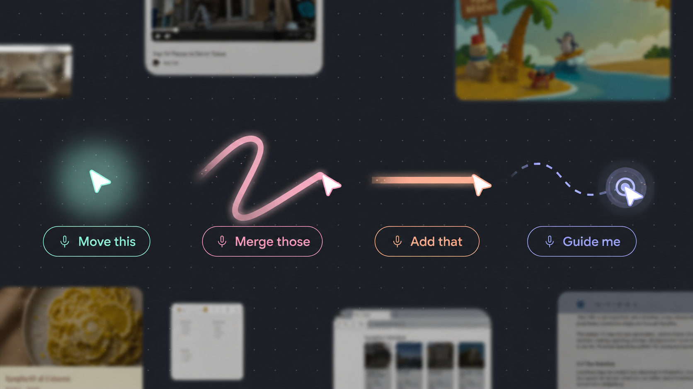
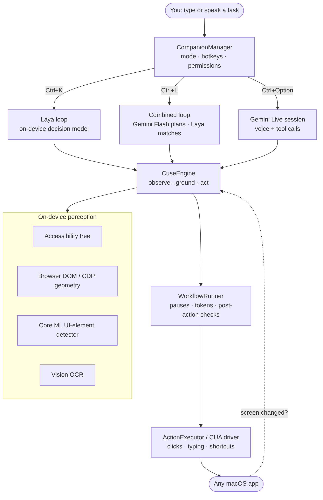

<div align="center">



# Cuse

### The open-source AI cursor agent for macOS

**Tell your Mac what to do — by typing or by voice — and Cuse moves the cursor, clicks, types and finishes the task for you.**
On-device UI grounding, a local decision model, and optional Gemini planning. No cloud proxy, no screen recording, MIT licensed.

[](https://github.com/muneebkhan08/Cuse/actions/workflows/ci.yml)
[](./LICENSE)
[](#requirements)
[](https://www.swift.org)
[](https://developer.apple.com/xcode/swiftui/)
[](https://developer.apple.com/machine-learning/core-ml/)
[](https://ai.google.dev)
[](CONTRIBUTING.md)
[](https://github.com/muneebkhan08/Cuse/stargazers)

[Features](#features) · [How it works](#how-it-works) · [Quick start](#quick-start) · [Tech stack](#tech-stack) · [Developer API](#developer-api-local-harness) · [FAQ](#faq) · [Contributing](CONTRIBUTING.md)

</div>

---

## What is Cuse?

**Cuse** (*cursor + use*) is a **computer-use agent** that lives in your macOS menu bar. Instead of explaining where to click, you just say what you want — *"click English"*, *"search for Alan Turing"*, *"open Notes and start a new note"* — and an AI-driven cursor finds the right control on screen and acts on it.

Unlike browser-only agents or cloud "computer use" sandboxes, Cuse works **on your real Mac, in any app** — Safari, Chrome, Finder, System Settings, Electron apps, creative tools — using the same signals a power user relies on: the macOS **Accessibility tree**, browser DOM geometry, **on-device Core ML UI-element detection** and **Vision OCR**. Every action goes through a single engine that grounds the target, delivers the input, and checks that the screen actually changed.

> **Cuse never invents pixel coordinates.** Models choose *which* detected control to act on; the engine supplies *where* it is.

## Features

| | Mode | Shortcut | What it does | Runs where |
|---|---|---|---|---|
| 🧠 | **Laya text** *(default)* | <kbd>Ctrl</kbd> + <kbd>K</kbd> | Type a click-based task. The local **Laya multilingual** model picks the matching on-screen control, then Cuse clicks, double-clicks, right-clicks, or types quoted text and presses Return. | **100% on-device.** No API key, no microphone. |
| ⚡ | **Combined text** | <kbd>Ctrl</kbd> + <kbd>L</kbd> | **Gemini Flash** plans each step from local screen labels; **Laya** matches each click to a real detected control. If they disagree, Gemini re-checks once — or stops instead of guessing. Also types, presses keys, runs shortcuts and opens apps. | Planning via Gemini; grounding on-device. |
| 🎙️ | **Gemini realtime voice** | <kbd>Ctrl</kbd> + <kbd>Option</kbd> | Talk about your screen. **Gemini Live** listens, optionally sees screenshots, and performs one desktop action per turn — clicks, typing, shortcuts, opening apps/URLs, scrolling, text edits, Apple Notes. | Gemini Live over WebSocket with *your* key. |

**Also built in**

- 🎯 **Focus painting** — hold <kbd>Ctrl</kbd> + <kbd>Shift</kbd> and paint over part of the screen to tell Gemini *"this area"*.
- 🔀 **Input chooser** — hold <kbd>Ctrl</kbd> + <kbd>Option</kbd> + <kbd>Cmd</kbd> to pick Speak / Type / Highlight.
- 🖱️ **Auto-click or point-only** — let Cuse act, or have it just show you where to click (guided tours, onboarding, accessibility help).
- 🛑 **Always interruptible** — <kbd>Esc</kbd> or **Stop** cancels the run and the active workflow instantly. Loops are bounded (12 actions for Laya, 15 for Combined).
- ✅ **Validated actions** — every step is grounded, executed, and checked for an on-screen change before the next one.
- 🧩 **Markdown app skills** — portable `SKILL.md` files teach Cuse app-specific quirks (user overrides → project skills → bundled skills).
- 🔌 **Local developer API** — drive the same engine from your own agent over `127.0.0.1` (see [Developer API](#developer-api-local-harness)).
- 🔐 **Keychain-only secrets** — your Gemini key is stored in the macOS Keychain. No environment variables, no hosted key, no proxy server.

## How it works



**Grounding order:** exact local IDs/marks → Accessibility → browser DOM/CDP → local Core ML + OCR → (Gemini voice only, as a last resort) screenshot coordinates.

**Laya, step by step**

1. Cuse detects every visible control and its label locally (AX + Core ML + OCR).
2. Candidates are ranked by rarity-weighted overlap with your words, so the control you named survives the 200-candidate cap.
3. The on-device **laya-multilingual** checkpoint (mmBERT-base, 322M params, 100+ languages, 8K context) picks one — or explicitly picks *none*.
4. The engine clicks it, types any text you quoted, presses Return, and validates the result.

Want the deep dive? Read **[ARCHITECTURE.md](ARCHITECTURE.md)** and the **[source layout](docs/source-layout.md)**.

## Quick start

### Requirements

- macOS **14.2 Sonoma** or later (Apple Silicon recommended for on-device inference)
- **Xcode** with the Swift 6 toolchain
- For **Laya**: Python 3.10+ (the Laya server runs locally on `127.0.0.1:8765`)
- For **Combined** or **Gemini voice**: a [Gemini API key](https://aistudio.google.com/apikey)

### 1. Build the app

```bash
git clone https://github.com/muneebkhan08/Cuse.git
```

```bash
open Cuse/Cuse.xcodeproj
```

Select the **Cuse** scheme, set your signing team, and press **Run** (<kbd>Cmd</kbd> + <kbd>R</kbd>). Swift packages resolve automatically.

> ⚠️ Build from **Xcode**, not terminal `xcodebuild` — replacing the signed app from the terminal invalidates its macOS Screen Recording and Accessibility permissions.

After the first build you can launch the newest build any time by double-clicking **`Start Cuse.app`** in the repo.

### 2. Install the Laya model (for the default, on-device mode)

Cuse launches the Laya server from `~/Library/Application Support/Cuse/laya`. Create that install once:

```bash
LAYA_HOME="$HOME/Library/Application Support/Cuse/laya" && mkdir -p "$LAYA_HOME" && python3 -m venv "$LAYA_HOME/.venv" && "$LAYA_HOME/.venv/bin/pip" install "laya==0.3.20"
```

```bash
LAYA_HOME="$HOME/Library/Application Support/Cuse/laya" && HF_HOME="$LAYA_HOME/hf" "$LAYA_HOME/.venv/bin/python" -c "from laya import Router; Router(max_loaded=1).preload(['multilingual'])"
```

The second command downloads the [`convaiinnovations/laya`](https://huggingface.co/convaiinnovations/laya) multilingual checkpoint once; afterwards Cuse runs it fully offline (on the GPU via Metal/MPS when available).

### 3. First launch

1. Click the Cuse icon in the menu bar and **choose a mode** (Laya is preselected).
2. **Gemini or Combined only:** paste your Gemini API key — both modes share it, and it's saved only to the Keychain.
3. **Grant permissions** for that mode:
   - **Accessibility** — to read controls and act in other apps.
   - **Screen Recording / Screen Content** — for local screen detection and optional screenshots. Cuse does **not** record video.
   - **Microphone** — Gemini voice only.
4. Press <kbd>Ctrl</kbd> + <kbd>K</kbd> and try: `Click English` on [wikipedia.org](https://www.wikipedia.org), or `search for Alan Turing`.

Switch modes any time in **Settings → Models**.

## Usage tips

- **Name the control you want.** Laya reads visible labels — `Click Downloads` beats `open my files`.
- **Quote text to type.** `type 'hello world'` or `search for Alan Turing` → Cuse clicks the field, types, and presses Return.
- **Need reasoning beyond the labels?** Use **Combined** (<kbd>Ctrl</kbd> + <kbd>L</kbd>) — e.g. *"open the German Wikipedia"* when the link says *Deutsch*, or icon-only buttons.
- **Want a conversation?** Use **Gemini voice** (<kbd>Ctrl</kbd> + <kbd>Option</kbd>), and paint focus with <kbd>Ctrl</kbd> + <kbd>Shift</kbd>.
- **Teaching, not doing?** Switch to **Point only** and Cuse shows where to click instead of clicking.

## Tech stack

| Layer | Technology |
|---|---|
| **App** | Swift 6, SwiftUI, AppKit (`NSPanel` / `NSHostingView`), menu-bar-only agent app (`LSUIElement`) |
| **Screen understanding** | macOS Accessibility API (`AXUIElement`), ScreenCaptureKit, browser DOM / Chrome DevTools Protocol geometry |
| **On-device vision** | Core ML UI-element detector (YOLO-style `UIElementDetector.mlpackage`), Apple Vision OCR, Core Image |
| **On-device decisions** | [Laya](https://huggingface.co/convaiinnovations/laya) `multilingual` (mmBERT-base, 322M) · Python · PyTorch (MPS) · Hugging Face Transformers, served on loopback |
| **Cloud models (optional, your key)** | Google **Gemini Live** realtime API (WebSocket, audio + tools) · **Gemini Flash** (`gemini-3.8-flash` → `gemini-3.7-flash` fallback) via REST `generateContent` |
| **Input delivery** | [CUA](https://github.com/trycua/cua) Swift driver (`CuaDriverCore`), CoreGraphics events |
| **Developer API** | Local HTTP/JSON harness on `127.0.0.1:19474` built on Network.framework |
| **Platform services** | Keychain (Security.framework), AVFoundation (mic + playback), ServiceManagement (launch at login), [Sparkle](https://sparkle-project.org) updates, [PostHog](https://posthog.com) usage events |
| **Quality** | Swift Testing decision suite (`scripts/test-jev.sh`), GitHub Actions CI |

## Developer API (local harness)

Cuse exposes its engine to developer tools and your own agents on **`127.0.0.1:19474`** (loopback only). It shares the exact grounding, permissions and validation that the built-in modes use.

```bash
curl -s http://127.0.0.1:19474/v1/agent-contract
```

Typical loop: `GET /v1/observe` → `POST /v1/ground-target` → `POST /v1/act` with the exact target ID → `GET /v1/action-history`. Keep one `trace_id` per task. Full contract: **[docs/cuse-agent-contract.md](docs/cuse-agent-contract.md)**.

## Privacy

| Data | Laya | Combined | Gemini voice |
|---|---|---|---|
| Your typed task | stays on this Mac | sent to Gemini Flash | — |
| Screen labels & positions | stays on this Mac | sent to Gemini Flash | — |
| Screenshots | never | only for a step that needs one **and** Screenshots is on | only when Screenshots is on |
| Microphone audio | never | never | streamed to Gemini Live |

- Screen detection, OCR and Laya decisions always run locally.
- The Gemini key lives only in the macOS Keychain and goes straight to Google — there is no Cuse server in between.
- Cuse sends anonymous app-lifecycle events (app opened, onboarding started, permission granted, voice shortcut pressed) to PostHog. It does not send screen content, tasks or transcripts.
- Screen Recording permission powers local detection; Cuse has no recording or video pipeline.

## Project structure

```
Cuse/
├── App/          Lifecycle, hotkeys, shared state, mode coordination
├── Core/         CuseEngine, action requests, harness contract
├── Jev/          Laya client, ranking & shortlist, validated decisions, click loop
├── Laya/         On-device Laya server launcher + laya_systemone.py
├── Combined/     Gemini Flash planner + Combined loop
├── Voice/        Gemini Live WebSocket, microphone, playback
├── Perception/   AX, browser geometry, Core ML + OCR, screenshots
├── Workflow/     Action schema, grounding, execution, pauses, validation
├── Actions/      Desktop input facade and CUA driver
├── Harnesses/    Localhost HTTP access to the engine
├── Skills/       Portable markdown app skills
├── UI/           Menu bar, settings, command panel, overlays
└── Utilities/    Permissions, Keychain, shortcuts, logging
CuseTests/        Decision-suite and unit tests
scripts/          test-jev.sh, release.sh
docs/             Architecture notes and the harness contract
```

## FAQ

<details>
<summary><b>Is Cuse an open-source alternative to cloud "computer use" agents?</b></summary>

Yes. Cuse is an MIT-licensed computer-use agent that runs natively on your Mac and controls real apps through the Accessibility API and an on-device UI detector. The default Laya mode runs entirely locally with no API key.
</details>

<details>
<summary><b>Does it work outside the browser?</b></summary>

Yes — any macOS app with visible controls: Finder, System Settings, Notes, Xcode, Electron apps (Cuse enables their accessibility tree automatically), creative tools and browsers.
</details>

<details>
<summary><b>Do I need an API key?</b></summary>

Not for Laya text mode. Combined and Gemini voice use your own Gemini API key, stored in the Keychain.
</details>

<details>
<summary><b>Can the AI click somewhere random?</b></summary>

Models never produce coordinates in Laya or Combined mode — they choose among detected, labelled controls, and the engine supplies the position. Every action is validated, runs are bounded, and <kbd>Esc</kbd> stops everything immediately.
</details>

<details>
<summary><b>Which languages does it understand?</b></summary>

The Laya multilingual checkpoint reads on-screen labels and tasks in 100+ languages; Gemini modes follow Gemini's language support.
</details>

<details>
<summary><b>Was Cuse previously called TipTour?</b></summary>

Yes. Cuse is the rebranded continuation of TipTour (itself forked from Clicky). If you used TipTour, macOS will ask for permissions again and you'll paste your Gemini key once more; an existing Laya install under `Application Support/TipTour/laya` keeps working.
</details>

## Roadmap

- [ ] Signed, notarized DMG releases with Sparkle auto-updates
- [ ] One-click Laya model installer inside onboarding
- [ ] Multi-step Laya plans for longer workflows
- [ ] More bundled app skills (Figma, VS Code, Office)

Have an idea? [Open a feature request](https://github.com/muneebkhan08/Cuse/issues/new/choose).

## Contributing

Contributions are welcome! Start with **[CONTRIBUTING.md](CONTRIBUTING.md)** and **[AGENTS.md](AGENTS.md)** (the architecture and naming guide for humans and coding agents). Please report security issues privately via **[SECURITY.md](SECURITY.md)**.

## License & credits

[MIT](LICENSE) © Muneeb Khan. Cuse builds on [TipTour](https://github.com/milind-soni/tiptour-macos) by Milind Soni and Clicky by Farza, and uses [CUA](https://github.com/trycua/cua), [Laya](https://huggingface.co/convaiinnovations/laya), [Sparkle](https://sparkle-project.org) and Google Gemini.

<div align="center">

**If Cuse saves you clicks, please ⭐ star the repo — it helps others find it.**

<sub>Keywords: AI cursor agent · computer use agent · macOS AI assistant · desktop automation · AI that controls your Mac · voice control · on-device AI · UI grounding · accessibility automation · Gemini Live · local LLM agent · open source</sub>

</div>
